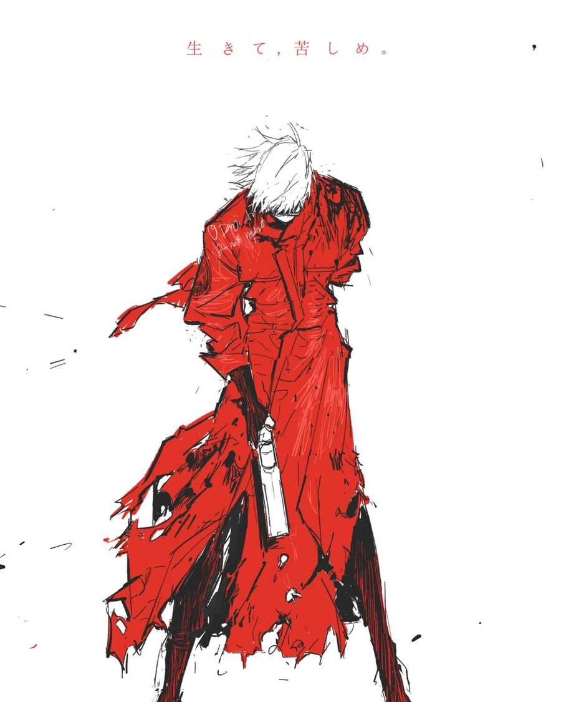

# Vellum

A static, animated one-page marketing site for **Vellum**, an AI creative canvas. Built with Vite and vanilla JavaScript/CSS — no framework, no backend.

Hero copy: *One canvas. Every creative outcome.* The agent is **Ada**.

The repo root is a plain static site on its own. You can serve it with any file
server — no install or build step required.

---

## Run it

### Plain static (no build, no dependencies)

```bash
python3 -m http.server 8000
# or: npm run serve
# → http://localhost:8000
```

Everything the page needs (`index.html`, `src/`, `fonts/`, `media/`, `favicon.svg`)
is committed at the repo root, so this is the simplest way to run or preview it.

### With Vite (optional dev server + production build)

```bash
npm install
npm run dev      # http://localhost:5173
npm run build    # → dist/
npm run preview  # serve the production build
```

Requires Node 18+.

---

## What's here

| Section | File | Notes |
| --- | --- | --- |
| Hero + animated ribbon | `index.html`, `src/styles/hero.css`, `src/modules/ribbon.js` | DOM/CSS 3D cards following a bow-tie path |
| Logo marquee | `.logos`, `.marquee` in `src/styles/sections.css` | Text wordmarks, not real logos |
| Brief / Assemble / Steer | `#how` | CSS-only mini illustrations |
| Dark canvas showcase | `#canvas`, `src/modules/showcase.js` | Tabbed mock product UI, auto-cycles every 8.2s until clicked |
| Gallery + filters | `#work`, `src/modules/gallery.js` | Filterable, reveal-animated tiles |
| Final CTA | `#cta` | Second simulated prompt bar |
| Footer | `.footer` | Oversized wordmark |

Design tokens (colors, type, easing, spacing) live in `src/styles/tokens.css`.
Stylesheets are linked directly from `index.html` so the root works without a
bundler.

---

## Imagery

The 22 photographs in `media/photos/` (`photo-01.jpg` … `photo-22.jpg`) are a
curated selection from the supplied image archive, cropped to a consistent
4:5 (900×1125) and compressed for the web. They are used in the hero ribbon,
the canvas showcase, and the gallery.

You can replace them without touching the CSS. Three places read imagery:

### 1. The hero ribbon

`src/data/media.js`

```js
export const photos = [
  { id: 'f01', src: './media/photos/photo-01.jpg' },
  // …add or replace entries
];

// Order the ribbon cycles through. Repeat, shorten, or reorder freely.
export const ribbonSequence = ['f05', 'f10', 'f02', ...];
```

- Drop your files in `media/photos/` (or anywhere under the repo root).
- Point `src` at them with a relative path, e.g. `./media/photos/hero-01.jpg`.
- **Aspect ratio:** 4:5 portrait crops best. The ribbon cards use `object-fit: cover`,
  so other ratios work but will crop. Recommended export: 900×1125 or larger.
- To remove the ribbon entirely, delete `<div class="ribbon" …>` from `index.html`.
- `ribbonSequence` accepts IDs from `photos`; add as many as you like.

### 2. The dark canvas showcase

`src/data/media.js` → `canvasSets`

```js
export const canvasSets = {
  campaign: { images: ['f05', 'f13', 'f18'], prompt: '…', count: '4 directions' },
  film:     { images: ['f15', 'f21', 'f02'], prompt: '…', count: '3 cuts' },
  lookbook: { images: ['f14', 'f04', 'f20'], prompt: '…', count: '6 spreads' },
};
```

Each set fills three canvas nodes left → right. Same `photos` IDs apply.
**Aspect ratio:** the nodes are cropped to a landscape frame, so use the same
4:5 files or supply landscape crops — `object-fit: cover` centres them.
Edit the tab labels in `index.html` (`.canvas-ui__tab`) if you rename a set
(the `data-set` value must match the key in `canvasSets`).

### 3. The gallery

`index.html`, inside `#gallery-grid`. Each tile is a `<figure>`:

```html
<figure class="tile" data-tags="brand" data-reveal>
  
  <figcaption>
    <span class="tile__title">Project name</span>
    <span class="tile__meta">Category · Year</span>
  </figcaption>
</figure>
```

- `data-tags` drives filters: `brand`, `product`, `editorial`, or `motion`
  (a tile can have several, space-separated).
- Class options: `.tile` (4:5 portrait), `.tile--tall` (also 4:5), `.tile--wide`
  (13:8 banner spanning two columns). Keep the `width`/`height` attributes roughly
  matching your file so the layout doesn't jump while loading.
- Update `alt` and the caption text. Decorative images (the ribbon and canvas
  nodes) deliberately use `alt=""`.
- To add a tile, copy a `<figure>` block. To remove one, delete it.
- Filters are defined in the `.filters` button group above the grid; add a
  `<button class="filter" data-filter="…">` to introduce a new tag.

### Fonts

Self-hosted in `fonts/`:

- `instrument-serif.woff2` + `instrument-serif-italic.woff2` — display serif
- `inter-var.woff2` — variable UI sans

Replace the files and update the `@font-face` blocks at the top of
`src/styles/tokens.css` if you change families.

---

## Prompt bar behavior

Both prompt bars (`#prompt-hero` and `#prompt-cta`) are a **simulated demo**, not a
real submission. `src/modules/prompt.js`:

- Types rotating example briefs into a ghost placeholder, pauses on hover/focus.
- On submit: shows “Ada is reading the brief…”, then “Assembling four directions…”,
  then “Four directions added to your canvas ✓”.
- Resets after a few seconds.

To wire it to a real endpoint, replace the `setTimeout` sequence in the `submit`
handler with a `fetch()` and drive the `is-busy` / `is-done` classes from the
response. No other code assumes a backend.

---

## Motion & accessibility

- The ribbon pauses off-screen, on tab blur, and when the user prefers reduced motion.
- `prefers-reduced-motion: reduce` disables the ribbon animation, marquee, caret
  blinking, reveal transitions, and showcase auto-cycling.
- Showcase tabs support arrow-key navigation; gallery filters expose `aria-pressed`.
- A skip link, visible focus rings, and labeled form controls are included.

---

## Deployment

### GitHub Pages

This repo is published straight from the `main` branch root — no CI or build
step required, because the root is already a static site.

- **Settings → Pages → Build and deployment**
- **Source:** Deploy from a branch
- **Branch:** `main` · folder `/ (root)`

The site is live at `https://<user>.github.io/window/`.

All asset paths are relative (`./src/…`, `./media/…`), so subdirectory hosting
works without any config. If you'd rather publish the minified `dist/` output,
run `npm run build` and point Pages at a `gh-pages` branch — or add a GitHub
Actions workflow using `actions/upload-pages-artifact` (note: pushing workflow
files requires the `workflow` scope on your GitHub CLI/token).

### Any other static host

`npm run build` emits a fully static `dist/`. Upload it to Netlify, Vercel,
Cloudflare Pages, S3, nginx — no server-side runtime needed. You can also serve
the repo root as-is with `python3 -m http.server`.

---

## Notes

- `Hero section ui.mp4` in the project root is the visual reference that inspired
  the layout and motion. It is **not** loaded by the site and can be deleted or
  moved before deploying.
- Gallery `alt` text is intentionally generic (it names the project, not the
  scene). Rewrite it to describe each photograph once you've picked final art.
